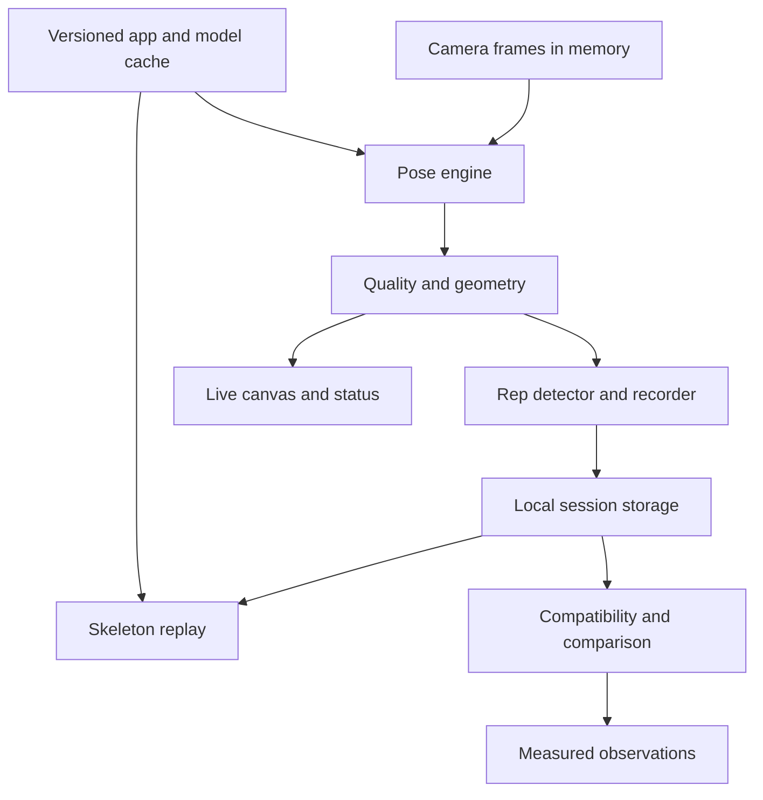

# Menhel Motion Master MVP

## 0. What this document controls

Version 1.1. Research checked on October 10, 2026. M3–M8 feature implementation is present; final browser verification and physical-device acceptance are recorded separately.

Quick navigation

- [Product scope](#2-product-contract)
- [Stack and versions](#3-stack-and-dependency-policy)
- [Guidelines and AI skills](#4-guidelines-and-ai-skills)
- [Architecture](#5-repository-migration-and-architecture)
- [Movement algorithms](#7-geometry-and-movement-algorithms)
- [Replay and comparison](#9-replay-and-comparison)
- [PWA behavior](#11-pwa-and-offline-behavior)
- [M0–M9 roadmap](#13-step-by-step-implementation-roadmap)
- [Verification](#14-verification-contract)
- [Definition of done](#16-definition-of-done-and-demo)
- [Source registry](#19-source-registry)

This is the single build contract for the HackRU web version of Menhel. It contains the product scope, stack, source guidelines, AI skill plan, algorithms, data contracts, execution order, acceptance checks, and demo plan. Follow the numbered milestones in order. Update this document when evidence changes a decision.

**The complete MVP is an installable web app that captures a short set of bodyweight squats, counts completed repetitions, saves joint movement locally, plays back a skeleton, and compares two attempts with measurement-based observations.**

Its central feature is Movement Replay. The user sees what changed between attempts. A chat interface is not part of the MVP.

Evidence labels used throughout this document

| Label | Meaning |
| --- | --- |
| Verified source fact | Confirmed in a linked maintainer document or the checked repository |
| Build decision | A choice we are making for this project |
| Starting heuristic | A proposed parameter that requires fixture and device testing |
| Unresolved | We do not have sufficient evidence yet |
| Acceptance target | A requirement to measure during implementation, not an achieved result |

Do not turn a starting heuristic into a claim of clinical accuracy. Do not turn a planned feature into an implemented feature. A passing build does not prove camera tracking works on a phone.

## 1. Existing project and event facts

### 1.1 Repository baseline

| Item | Verified state |
| --- | --- |
| Working repository | [shuknuk/hackru-fall-2026](https://github.com/shuknuk/hackru-fall-2026) |
| Imported Menhel source | [shuknuk/menhel-ai-analyzer](https://github.com/shuknuk/menhel-ai-analyzer) |
| Source snapshot | `943ac34aa12d4f900a4a170f8dbde6234883bed2` |
| Import commit | `7a77ebaf1c1cd3b37dc190816834f10b912f4862` |
| Imported files | 47 tracked files, including four PNG assets |
| Exact imported tree | `f586e59619ec16c33264ff4c11ffb6e6648e9f6b` |
| Imported application | React Native, Expo, TypeScript, custom Swift modules, now archived |
| Native pose implementation | Apple Vision through `VNDetectHumanBodyPoseRequest` |
| Current repetition signal | Hip movement rather than the new angle-based algorithm |
| Web MVP | Camera, calibrated capture, replay, comparison and offline preparation implemented; device acceptance pending |

The inherited README and `CLAUDE.md` describe some functionality more broadly than the code supports and describe the native tracking as MediaPipe. They are historical documentation. The Swift implementation is the authoritative evidence for the imported native tracker.

The import has no fork relationship. The original Menhel repository remains unchanged. We will implement browser tracking independently. Swift, Expo modules, React Native views, and native storage are not browser-compatible dependencies.

### 1.2 HackRU

The official website identifies Fall 2026 as a 24-hour event on October 10–11 at Busch Student Center. It lists Social Good, Education, and Maverick, with additional sponsor prizes. [S01]

**Chosen project direction is Social Good.** This is our interpretation of the track description. The pitch is affordable access to understandable movement feedback through an ordinary camera. We are not claiming organizer approval or guaranteed eligibility.

**Unresolved before submission**

- The Fall 2026 policy on pre-existing code and earlier projects.
- Submission requirements, AI-use disclosure, and current sponsor challenges.

The official schedule was rechecked during implementation on October 10. It lists Saturday noon hacking start, Sunday noon submissions due, and Sunday 1 PM judging start. The FAQ sets a maximum of four humans per team. Actual team size and demo devices remain unconfirmed. See [execution evidence](docs/EXECUTION.md). [S01]
- Whether an earlier project that was not judged may be reused. Not winning or not presenting does not establish permission.

The public website did not resolve these rules, and the attempted Fall 2026 Devpost URLs were inaccessible during research. Do not use Fall 2025 rules as proof of Fall 2026 rules. Ask an organizer and record the answer, source, and time in this document. No contact has been sent on the team's behalf.

Preserve the import provenance and identify what was created during HackRU. If reuse is prohibited, keep the imported tree out of the submitted implementation and follow the organizer's interpretation of independently built work. Do not assume moving files into an archive makes reuse eligible.

## 2. Product contract

### 2.1 User and problem

A person exercising independently can see a repetition but may struggle to compare how they moved across attempts. Menhel Motion makes the movement visible and the differences understandable without wearables, an account, or a trainer subscription.

The primary user is someone who can comfortably perform their own bodyweight squats. A judge can use the sample replay without exercising. The product should work for a comfortable personal range of motion instead of demanding a universal depth.

This is an observation tool. Single-camera estimates are not injury diagnoses, clinical joint measurements, or proof that a movement is safe.

### 2.2 The complete user journey

1. Open the HTTPS web app on a supported device.
2. See a plain explanation of camera use and local storage.
3. Choose **Start Camera**. No camera permission request occurs on landing.
4. Select front or rear camera if available.
5. Place the camera at a stable side view with the full body visible. The setup screen explains lighting, distance, framing, and a comfortable range.
6. Stand still briefly. Confirm the visible body side and complete a setup repetition at a comfortable depth.
7. Start Set A. Perform three repetitions for the judge demo, with a maximum of ten in a normal MVP session.
8. Finish the set. The camera stops, and results show completed repetitions, tracking quality, and estimated movement metrics.
9. Select a repetition and play its skeleton replay. Scrub the timeline and inspect the measured angles.
10. Choose **Record Another Set**. Keep the camera placement and setup profile for Set B, then recheck framing before recording.
11. Compare Set A and Set B, first as a summary and then with two selected repetitions synchronized by movement phase.
12. Read up to three observations tied to specific measurements. More movement is not automatically called better movement.
13. Reopen saved sessions, export a session file, or delete local data.
14. Install the app where the browser supports it. Installation is optional for using the web app.

### 2.3 Required scope

P0 establishes the capture and replay foundation. P1 completes the promised MVP. The project is not done until both pass their acceptance checks.

| ID | Priority | Feature | Concrete completion condition |
| --- | --- | --- | --- |
| F01 | P0 | Browser application | Responsive Next.js app loads without Expo or native imports |
| F02 | P0 | Camera setup | Explicit permission, camera selection, framing help, permission recovery |
| F03 | P0 | Live body tracking | Full-body skeleton follows the visible person with honest confidence states |
| F04 | P0 | Estimated angles | Aspect-corrected projected knee and hip angles, null when unreliable |
| F05 | P0 | Squat counting | One completed down-and-up cycle counts once; partials and tracking gaps do not create reps |
| F06 | P0 | Session capture | Bounded timestamped landmark data and metrics, no raw video recording |
| F07 | P0 | Local persistence | Saved session survives reload; failure is explained and offers export |
| F08 | P0 | Movement Replay | Rep selector, play/pause, scrubber, speed, angles, gap handling |
| F09 | P1 | Attempt comparison | Set summary plus phase-aligned selected-rep replay with compatibility checks |
| F10 | P1 | Grounded observations | Deterministic text links to measured differences or explains insufficient data |
| F11 | P1 | Installable PWA | Manifest and icons, working platform install guidance, standalone phone verification |
| F12 | P1 | Offline replay | Previously saved sessions and replay work after deliberate offline preparation |
| F13 | P1 | Data controls | History, delete, delete all, bounded JSON export and import |
| F14 | P1 | Accessible demo | Keyboard controls, text alternatives, clear sample labels, responsive layout |
| F15 | P1 | Verified release | Production build, real-device flow, repeatable demo, provenance and limitations |

### 2.4 Explicit scope boundary

The MVP supports one person, one exercise, one side-view setup, and short sets. It does not implement mood tracking, mental-health chat, HRV, recovery scores, exercise libraries, WhatsApp, calendars, accounts, cloud sync, payments, medical prescriptions, automatic injury detection, or an overall form grade.

It does not promise live tracking on every browser or every phone. Browser access is broadly useful; camera inference and install behavior still depend on the environment. Google names Chrome and Safari in its MediaPipe web setup requirements. These are the initial live-tracking targets. Edge and Firefox must be tested separately before claiming support. [S04]

Front-view asymmetry analysis, knee valgus detection, 3D avatars, raw-video replay, loaded squats, and additional exercises are post-MVP work.

### 2.5 Stretch features after the release gate

Optional Gemini summaries may rewrite the existing deterministic observations into plain language. They must never calculate reps, infer unseen movement, or decide whether tracking is valid. The core flow works without an API key or network.

Optional speech feedback may read short setup or rep messages. It requires user control and text equivalents. Neither stretch feature can displace comparison, PWA verification, or demo rehearsal.

## 3. Stack and dependency policy

### 3.1 Chosen stack

These are build decisions. Exact direct versions are pinned in package.json and recorded with compatibility metadata in [the dependency ledger](docs/dependency-metadata.json). The clean install/typecheck/lint/build passed; real-device acceptance remains pending. Documentation versions are not proof that the same package release is available or compatible.

| Layer | Selected technology | Responsibility | Guideline sources |
| --- | --- | --- | --- |
| Framework | Next.js App Router, stable release | Routes, shell, manifest, deployment | S02, S03, S06 |
| UI | React and React DOM, compatible pair | Screen state and controls | S07, S08 |
| Language | TypeScript with strict checks | Typed session and worker contracts | S09 |
| Styling | Tailwind CSS v4, `@tailwindcss/postcss`, PostCSS | Responsive styling and tokens | S10, S11, S42 |
| Icons | `lucide-react` | Small named icon imports | S12 |
| Pose inference | `@mediapipe/tasks-vision` | Browser Pose Landmarker | S04, S05 |
| Pose model | Official Pose Landmarker Lite `.task` bundle initially | Local pose estimates | S13 |
| Capture | Browser `getUserMedia`, HTML video | Camera input | S14, S15 |
| Frame scheduling | `requestVideoFrameCallback`, guarded RAF fallback | Process fresh frames with monotonic timestamps | S16 |
| Rendering | Canvas 2D and a small SVG chart | Live skeleton, replay, angle trace | S17 |
| Background compute | Web Worker, transferable ImageBitmap where verified | Keep inference off the UI thread | S18, S19 |
| Persistence | IndexedDB through `idb` | Local sessions and settings | S20, S21 |
| Runtime validation | Zod | Stored data, imported files, worker boundary checks | S22 |
| PWA | Native manifest and a small custom service worker | Installation and explicitly bounded offline cache | S02, S23, S24 |
| Unit tests | Vitest with its compatible Vite dependency | Geometry, segmentation, comparison and schema logic | S25, S26 |
| Browser tests | `@playwright/test` | User flows, fixtures, errors, reload, offline behavior | S27, S28 |
| Lint | ESLint and matching `eslint-config-next` | Framework, hooks and TypeScript checks | S29 |
| Hosting | Vercel preview, then the team's chosen public release URL | HTTPS distribution | S30 |

No chart package, global state library, UI component suite, animation library, PWA plugin, Python backend, TensorFlow.js runtime, or database server is needed for the core MVP. Use native semantic controls, React state/reducers, CSS, Canvas, and SVG. Add a dependency only for a named requirement that the existing stack cannot meet cleanly.

### 3.2 Version freeze procedure

Before implementation milestone M1 passes

1. Check npm metadata for every selected package, including `version`, `engines`, peer dependencies, repository, and license. Use official registries and package maintainer sources.
2. Select a stable Next.js release and its supported React/React DOM pair. Avoid canary runtime packages.
3. Verify Node requirements against Next.js, the selected test runner, and Vercel. Current Vitest guidance requires Node 22.12 or newer, which is stricter than the Next.js documentation's stated minimum. [S06, S25]
4. The current workspace runs Node `24.19.0` and npm `11.9.0`. Those observations do not verify teammate machines or a future deployment environment.
5. Pin direct dependency versions and the Node release used for the build. Commit `package-lock.json`. Use `npm ci` after the freeze.
6. Copy the WASM support files from the exact installed MediaPipe package. Never mix SDK JavaScript from one version with WASM from an unpinned CDN.
7. Download the model through Google's model link, record its exact URL, SHA-256, size, retrieval date, and license/model-card attribution. Use a versioned local path.
8. Confirm the model and WASM requests return bytes, not an HTML fallback page. Verify their response status, content type, and hashes.
9. Record the resolved versions, selected docs, license findings, and initial build result in the version table below.
10. Do not upgrade packages during the hackathon unless a specific blocker requires it. Rerun affected checks after any upgrade.

| Item to freeze | Current status |
| --- | --- |
| Node and npm for implementation/deployment | Local Node 24.19.0/npm 11.9.0 verified; Node 24.x staging builds passed |
| Next.js, React, React DOM | 16.4.0 / 19.3.0 / 19.3.0, build passed |
| TypeScript, lint and styling packages | TS 5.9.3, ESLint 9.39.5/config 16.4.0, Tailwind/PostCSS plugin 4.3.3; checks passed |
| MediaPipe SDK, WASM and model checksum | SDK/model/WASM checksums prepared and browser inference verified; physical-device performance pending |
| `idb`, Zod and Lucide | 8.0.4 / 4.6.5 / 1.55.0, pinned; features pending |
| Vitest, Vite and Playwright | 5.0.3 / 8.3.4 / 1.64.0; Chromium 153 browser provisioning workaround verified |

See [the execution ledger](docs/EXECUTION.md) for the actual selected versions and clean build evidence. MediaPipe assets, phone/browser runtime and deployment evidence remain separate gates.

Registry metadata snapshot, retrieved with `npm view <package> version engines peerDependencies license --json` on October 10, 2026

| Package | Observed latest stable tag | Selection status |
| --- | --- | --- |
| `next` / `eslint-config-next` | `16.4.0` / `16.4.0` | Candidate matching pair; build not tested |
| `react` / `react-dom` | `19.3.0` / `19.3.0` | Candidate matching pair; Next.js declares support for React 19 |
| `typescript` | `7.0.2` | Candidate; verify Next.js tooling compatibility before adopting this major |
| `tailwindcss` / `@tailwindcss/postcss` | `4.3.3` / `4.3.3` | Candidate matching pair |
| `postcss` | `8.5.29` | Candidate |
| `lucide-react` | `1.55.0` | Candidate; declared React peer includes 19 |
| `@mediapipe/tasks-vision` | `1.1.0` | Candidate; exact asset/runtime compatibility must pass M2 |
| `idb` | `8.0.4` | Candidate |
| `zod` | `4.6.5` | Candidate |
| `vitest` / `vite` | `5.0.3` / `8.3.4` | Candidate pair; Vitest declares Vite 8 support |
| `@playwright/test` | `1.64.0` | Candidate |
| `eslint` | `10.12.0` | Candidate; verify all framework lint plugins, not only the top-level peer |

The snapshot proves registry availability and declared metadata, not runtime compatibility. Node `24.19.0` satisfies the observed top-level engine ranges, but transitive dependencies, TypeScript tooling, native build dependencies and deployment still need a clean-install check. Resolve type declaration packages with the scaffold and record them in the frozen lockfile. If a major version breaks compatibility, choose a supported stable alternative with a recorded reason rather than forcing peer dependencies. [S43]

## 4. Guidelines and AI skills

### 4.1 How the agent uses references

Before editing a module, read the relevant official documentation and the applicable selected skill. Use docs matching the installed package. A skill is a coding workflow, not evidence that the resulting code is correct.

The current Next.js AI-agent guide documents bundled version-matched docs and managed agent instructions. The old `vercel-labs/next-skills` repository says `next-best-practices` is no longer an installable skill and points workflow skills to `vercel/next.js`. Do not install a stale recipe simply because a skills directory lists it. [S03, S31]

We inspected the following skill sources. Their upstream names, requirements, and purpose matter more than popularity. Skills are researched here, not installed by this planning commit.

| Skill or agent guidance | Provenance | Decision | Apply when |
| --- | --- | --- | --- |
| `vercel-react-best-practices` | Vercel Labs `agent-skills` | Selected | Writing/reviewing React components, lazy ML loading, refs, render frequency |
| `web-design-guidelines` | Vercel Labs `agent-skills` | Selected | Reviewing all MVP screens for focus, accessibility, touch and layout |
| Bundled Next.js docs and managed `AGENTS.md` | Next.js maintainers | Required where present in the selected stable package | Routes, client boundaries, manifest, build config and worker bundling |
| `next-dev-loop` | Next.js repository | Conditional workflow | Runtime checks only when all its prerequisites are satisfied |
| `next-bundle-optimizer` | Next.js repository | Conditional audit | Investigating initial-load ML cost after functionality works |
| `playwright-cli` | Microsoft Playwright | Selected if the CLI is available | Browser inspection, console/network checks, screenshots and flow validation |
| Playwright Test Agents | Microsoft Playwright | Optional planning/generation references | Test authoring; no automatic delegation required |
| `vitest` | Anthony Fu `antfu/skills`, generated from Vitest | Optional community reference | Unit-test config and fixtures after checking its version against installed Vitest |
| `pose-analysis` | Community `jayv29/pose-analysis-skill` | Reviewed, not adopted | Its Python/iCloud/Chinese coaching-report workflow does not match this browser application |

The community pose skill is not an official Google skill and does not prove browser SDK support or clinical validity. Its emphasis on evidence quality is useful context, but we will implement our own browser quality gates from the product contract and primary API docs. No scripts from that repository are required.

For MediaPipe, Tailwind, TypeScript, Zod, idb, Lucide, native browser APIs, and the custom PWA worker, this research did not establish a suitable maintainer-owned installable skill for each individual library. Use the official docs plus the project-specific rules below. We are not claiming that no such skill exists anywhere.

### 4.2 Verified skill locations and reviewed revisions

| Source | Revision observed during research | Relevant paths |
| --- | --- | --- |
| `vercel-labs/agent-skills` | `063bee94c3f4df8453406c830b0a7df0f2860278` | `skills/react-best-practices/`, `skills/web-design-guidelines/` |
| `vercel/next.js` canary skill sources | `d8bfc3c994670c367e6e31853b78f42e8b7fba85` | `skills/next-dev-loop/`, `skills/next-bundle-optimizer/` |
| `microsoft/playwright` | `d9f2fd3e2232ace8e317a84eda6cb86e25bcf49c` | `packages/playwright-core/src/tools/skills/playwright-cli/` |
| `vercel-labs/web-interface-guidelines` | `434b7f91364665f2f733b310ec54809bf8f37937` | `command.md` |
| `antfu/skills` | `feb0f3aba6566426f12230e7fc7a10d97c1293bb` | `skills/vitest/` |

These hashes pin the inspected upstream snapshots, not an installed environment. Select a version-compatible snapshot at M1, retain license notices, and record any change. Fetch each selected directory with its referenced files, not only `SKILL.md`. Do not execute an installer or bundled script without reviewing its effect.

Maintainer-documented installation commands to verify against the installer before use

```bash
npx skills add vercel-labs/agent-skills --skill vercel-react-best-practices
npx skills add vercel-labs/agent-skills --skill web-design-guidelines
npx skills add vercel/next.js --skill next-dev-loop
npx skills add vercel/next.js --skill next-bundle-optimizer
```

These commands track upstream state. For reproducible use, select the reviewed commit through the installer's supported ref mechanism or copy the complete licensed skill directory from that commit. Read current CLI help rather than inventing pin flags.

The inspected `next-dev-loop` requires Next.js 16.3+, Turbopack, a live `/_next/mcp` endpoint, and `agent-browser` 0.31.1+. If those requirements are absent, do not pretend the skill ran. Leave it unselected for that environment and execute this document's independent Playwright/manual verification contract. Do not use the skill's name to describe weaker checks. [S32]

Playwright's official agent setup is documented as `npx playwright init-agents --loop=codex`. It is optional. This plan does not require spawning sub-agents or using an automatic healer. Read the installed CLI help before generating agent files. Never let a healer remove meaningful assertions to make a failing product pass. [S28]

### 4.3 Project rules by subsystem

| Subsystem | Rules the implementation agent must follow |
| --- | --- |
| Next.js | Keep the shell server-renderable. Put camera/browser APIs in client modules. Lazy-load the tracker after intent. Verify installed worker bundling behavior. Do not add Server Actions or API routes for local-only functionality. |
| React | Keep frame buffers, worker handles and draw state outside per-frame React state. Publish coarse UI changes at a bounded rate. Effects must clean up media, callbacks and workers, including development remounts. |
| TypeScript | Enable strict checks. Model lifecycle and worker messages as discriminated unions. Validate external/stored data at runtime. Do not use `any` to hide a browser compatibility problem. |
| MediaPipe | Use the Tasks Vision Pose Landmarker API, `VIDEO` mode for browser camera frames, one pose, segmentation off, matched local assets, and monotonically increasing timestamps. Do not copy another platform's `LIVE_STREAM` options into the web API. |
| Tailwind | Use the selected v4 PostCSS setup and CSS tokens. Prefer fixed class maps to dynamically assembled utility names. Check the target browser against Tailwind's compatibility docs. |
| Lucide | Use named imports and consistent sizes. Decorative icons are hidden from assistive tech; icon-only controls have accessible names. |
| idb | Separate schema migration from session logic. Keep transactions short. Do not await unrelated network or inference work inside a database transaction. Handle blocked upgrades and write errors. |
| Zod | Validate bounded imports and stored records with `safeParse`. Include schema versions, finite-number checks, enum restrictions and size limits. Types alone do not validate JSON. |
| Camera | Start on user intent. Request video only. Use `muted` and `playsInline`. Handle unavailable, denied and busy devices. Release tracks on stop, unmount, interruption and stale async completion. |
| Worker | One frame in flight. Drop excess incoming frames. Close transferred bitmap resources. Associate every reply with an engine generation and session ID. Ignore replies for stopped or replaced sessions. |
| Canvas/SVG | Use consistent image-space transforms. Account for aspect ratio, letterboxing, mirroring and device pixel ratio. Keep accessible metric text outside the canvas. |
| PWA | Installability and offline capability are distinct. Cache only known build assets. Never claim first-visit offline support or automatic permanent storage. Prevent updates from replacing a running recording session. |
| Vitest | Test numerical and lifecycle boundaries with meaningful fixtures. Use a dedicated test config, not assumptions that Next.js is a Vite application. |
| Playwright | Use role/label locators and retrying assertions. Separate deterministic pipeline fixtures from real inference/device evidence. Emulated WebKit is not a physical iPhone. |
| Deployment | Verify HTTPS, asset responses, no raw frame upload, no secrets in browser bundles, and the exact production build. Do not treat a successful deployment as a tested camera experience. |

Sources for these adapted rules are S02–S30 and S33–S38. Their application to this product is our design work.

### 4.4 Agent execution protocol

At the start of an implementation session

1. Read this document, repository instructions, recent changes, and the milestone ledger.
2. Identify the next unfinished milestone and its prerequisite checks.
3. Read the matching docs and selected skill. Prefer version-matched docs over memory.
4. State the bounded change and its acceptance test.
5. Implement the smallest vertical slice that can satisfy that test.
6. Run relevant checks. Capture outputs and the environment used.
7. Fix a failed boundary before building features that depend on it.
8. Record implemented behavior, validation, unresolved limits, and the next step.
9. Commit a coherent change. Do not rewrite the imported provenance or the source repository.

Later, add a root `AGENTS.md` that points here, identifies `legacy/menhel/` as archival code, lists scripts and test boundaries, and preserves Next.js managed instruction blocks. Refresh `CLAUDE.md` to stop directing agents toward Expo/native APIs. Do not add conflicting duplicated master plans.

## 5. Repository migration and architecture

### 5.1 Clean web runtime

Build decision is one Next.js package at the repository root. At M1, move the 47 imported files into `legacy/menhel/` while preserving their bytes and recording the move. Keep this master document outside the archive. Archive instructions must be clearly scoped to archival code.

Then create a clean root Next.js package and lockfile. Exclude the archive from root lint, TypeScript and tests. Do not install Expo dependencies as part of the web build. Reuse the color direction and visual ideas after checking applicable event rules. Rewrite actual web components.

Planned module layout

| Path | Responsibility |
| --- | --- |
| `src/app/layout.tsx`, `page.tsx`, `globals.css` | Shell, navigation, design tokens |
| `src/app/session/page.tsx` | Camera setup, capture, and the current session |
| `src/app/history/page.tsx` | Local session list, export/import/delete |
| `src/app/replay/page.tsx` | Session and rep selection from validated query IDs |
| `src/app/compare/page.tsx` | Select and compare two compatible sessions |
| `src/app/manifest.ts` | Install metadata |
| `src/components/capture/` | Camera preview, overlay, setup help, controls |
| `src/components/replay/` | Replay player, scrubber, angle trace and comparison |
| `src/components/ui/` | Small semantic buttons, status and cards |
| `src/lib/pose/` | Engine interface, landmarks, geometry, quality, transforms |
| `src/workers/pose.worker.ts` | Worker inference adapter if the spike validates it |
| `src/lib/motion/` | Filtering, setup calibration, segmentation and metrics |
| `src/lib/session/` | Schemas, session recorder, compatibility and observations |
| `src/lib/storage/` | IndexedDB, migration and validated import/export |
| `src/lib/pwa/` | Registration, offline preparation and update coordination |
| `public/mediapipe/<sdk-version>/` | Matched WASM and loader files |
| `public/models/<model-version>/` | Official model bundle |
| `public/sw.js`, `offline.html`, `icons/` | Generated/maintained worker, offline fallback and icons |
| `public/demo/` | Clearly labelled consented/synthetic landmark fixtures |
| `scripts/` | Asset copy, cache manifest and reproducibility checks |
| `tests/unit/`, `tests/e2e/`, `tests/fixtures/` | Pure logic and full-flow tests |
| `legacy/menhel/` | Imported historical application |

Dynamic route rendering must not be required for offline replay. Query parameters identify local sessions on static replay/compare shells. All session reads happen in the browser.

### 5.2 Data boundaries



The media stream stays in memory. No `MediaRecorder`, photo capture, frame upload, cloud landmark storage, or face identification is required. Saved coordinates still describe personal movement, so users receive explicit local-data controls.

The only necessary network traffic is application and model/WASM delivery. With same-origin asset hosting, the tracker does not need third-party inference calls. If optional Gemini is enabled later, summary measurements leave the device only after an explicit user request and disclosure.

### 5.3 Pose engine contract

Both worker and fallback engines expose the same capabilities

- Initialize with pinned asset URLs and a selected delegate.
- Process one fresh frame with an increasing timestamp.
- Return a normalized internal pose frame, including confidence and timing.
- Report recoverable and fatal initialization/runtime errors.
- Close deterministically.

Frame messages include `type`, `engineGeneration`, `sessionId`, `frameId`, `timestampMs` and a transferred frame when applicable. Replies include the matching IDs, landmarks, inference duration and error classification. The browser discards obsolete replies.

Worker execution is a candidate design, not a proven cross-device property. Prototype the exact package, bundler, image transfer, WASM paths, GPU/CPU delegate and Safari behavior before committing to that engine.

Fallback order

1. Tested worker/delegate combination.
2. Worker CPU if GPU initialization fails and its performance is usable.
3. Throttled main-thread inference with the same session logic and an honest limited-performance status.
4. If none meets usable latency, provide sample replay and explain that live capture is unsupported on this device. Do not pretend the MVP live feature passed.

The first two orderings can change if measurements show the preferred combination is slower or unstable. Keep only paths that are actually tested. Avoid implementing every combination without evidence.

## 6. Camera, setup and quality contract

### 6.1 Lifecycle states

`idle → requesting-permission → loading-engine → positioning → calibrating → ready → recording → finishing → results`

Explicit branches include `permission-denied`, `camera-unavailable`, `model-error`, `tracking-lost`, `paused`, and `storage-error`.

Every transition has one owner. Prevent two concurrent Start operations. Stop means cancel scheduling, invalidate pending inference replies, stop media tracks, detach the video source, release bitmaps, and close the engine when leaving capture. A late permission response after Stop must be immediately released.

Use ideal camera constraints initially, such as a 640×480 processing source and an environment-facing camera where available. Actual stream dimensions are read from the video; ideal constraints are not guarantees. Do not request a microphone.

On page hiding or camera interruption, end the active rep as incomplete, pause capture, and release media. Resume requires user intent, a setup recheck and a new segment. Do not count a repetition across the interruption. Do not depend on `beforeunload` firing on mobile.

### 6.2 Setup instructions

- Put the camera on a stable support, roughly around hip height, and face sideways.
- Keep shoulders, hips, knees, ankles and feet in frame through the intended movement.
- Use enough light and separate the body from the background.
- Keep one person in view. The MVP tracks one selected pose; it does not reliably police all bystanders.
- Choose a visible side and verify the overlay follows that side.
- Stand comfortably for a baseline, then perform one comfortable setup repetition.
- Leave camera placement unchanged between the two compared sets.

Setup hints are based on observable framing and confidence. An automated side-view heuristic may help, but it cannot certify a precise camera angle. Ask the user to confirm the side-view setup.

### 6.3 Pose validity

Initial configuration ledger

| Parameter | Proposed initial value | Classification |
| --- | --- | --- |
| `runningMode` | `VIDEO` | Web API choice |
| `numPoses` | `1` | MVP scope |
| `outputSegmentationMasks` | `false` | Avoid unused segmentation output |
| Detection/presence/tracking confidence options | `0.5` each | Published web defaults; confirm installed declarations |
| Required-joint visibility gate | `0.6` when the field is available | Starting heuristic; validate against occlusion fixtures |
| Required-joint presence gate | `0.6` when the field is available | Starting heuristic; not a calibrated probability of correctness |
| Missing confidence fields | Mark confidence evidence unavailable and apply an explicitly tested adapter policy | Unresolved until M2; do not substitute fabricated confidence |

Record every tuned value with algorithm version and fixture/device evidence. A configuration change affecting segmentation or geometry invalidates old numerical comparisons unless a tested migration/reanalysis exists.

For each metric, require its own needed landmarks. Rep detection needs hip, knee and ankle on the locked side. Hip angle additionally needs shoulder. Missing shoulder may disable hip-angle feedback without manufacturing a knee error.

Validate finite coordinates, adequate visibility/presence when exposed by the installed SDK, nondegenerate limb lengths, and reasonable framing. Map real SDK fields into the internal contract and test that adapter. Do not assume a field appears merely because a different SDK version exposed it.

Pick the side with better sustained visibility during setup, then lock it for the set. Do not switch sides mid-rep. If that side becomes unavailable, show tracking loss and invalidate the active rep.

Proposed initial behavior is an immediate counting pause on invalid required landmarks. A visual overlay may retain a dimmed last pose for at most 150 ms, clearly stale. It cannot contribute to metrics. A short gap of at most 150 ms may preserve a candidate only when no phase transition is inferred across the gap, all three rep anchors have valid evidence, and valid coverage is at least 85%. Longer gaps invalidate that candidate. Gaps longer than 500 ms also reset the tracking/filter state and require a stable standing state before rearming. These durations and coverage thresholds are starting heuristics.

## 7. Geometry and movement algorithms

This section is our proposed algorithm, not a Google-provided squat classifier or a clinically validated protocol. Implement pure functions first and test them independently of the UI.

### 7.1 Coordinates and joint indices

MediaPipe's normalized x and y use image width and image height respectively. The MVP converts them to a common pixel scale before computing projected angles. [S05]

For image dimensions W and H

\[
p=(xW,\ yH)
\]

Computing an angle directly from `(x,y)` without correcting a non-square image distorts the geometry. Camera mirroring is a display transform; it does not change anatomical left/right IDs or the stored calculation coordinates.

The side indices used by the implementation must be checked against the selected SDK/model reference. Intended standard Pose Landmarker mapping is shoulder 11/12, hip 23/24, knee 25/26, ankle 27/28, heel 29/30, and foot index 31/32. Add a mapping fixture so left and right cannot silently reverse.

For three points A, B and C, the interior angle at B is

\[
u=A-B,\quad v=C-B
\]

\[
\theta=\frac{180}{\pi}\arccos\left(\operatorname{clamp}\left(\frac{u\cdot v}{\|u\|\|v\|},-1,1\right)\right)
\]

If either vector length is below epsilon or an input is invalid, return null. Do not turn a failed computation into zero degrees.

- Knee interior angle uses hip, knee, ankle.
- Knee flexion estimate is `180 − kneeInteriorDeg`.
- Hip interior angle uses shoulder, hip, knee.
- Hip flexion estimate is `180 − hipInteriorDeg`.
- Torso lean estimate uses the shoulder-to-hip vector relative to image vertical.

UI labels say **estimated knee flexion**, **estimated hip flexion**, and **projected torso lean**. They do not say laboratory range of motion or true 3D joint angle. World landmarks are model estimates; they are not a calibrated motion-capture system. World-space measurement is deferred.

### 7.2 Overlay transforms

Use `object-fit: contain` for the capture preview initially. With container Cw×Ch and source W×H

\[
s=\min(C_w/W,C_h/H),\quad o_x=(C_w-sW)/2,\quad o_y=(C_h-sH)/2
\]

Map a normalized landmark to `(ox + sxW, oy + syH)`. For a mirrored preview, mirror the video and overlay consistently within the same content rectangle. Handle canvas backing-store scale separately using device pixel ratio. Recompute on resize/orientation changes.

Never calculate angles in CSS display coordinates after unequal scaling. Test portrait and landscape containers, mirrored/unmirrored cameras and letterboxing.

### 7.3 Smoothing and timestamps

Store the measurement input and validity flags. Keep a separate filtered signal for rep segmentation and a clearly documented derived signal for displayed metrics.

Start with a time-aware exponential filter

\[
\alpha=1-e^{-\Delta t/\tau},\quad y_t=\alpha x_t+(1-\alpha)y_{t-1}
\]

Initial proposed `tau` is 80 ms. Do not carry the filter through an invalid gap. Reset it at rearming. Tune smoothing from noisy and fast-rep fixtures, not from visual preference alone.

Use one monotonic capture clock. The engine receives strictly increasing timestamps in milliseconds. Session times are relative to session start. Store capture time, not merely result-arrival time. Do not infer duration from a fixed frame rate.

The JavaScript class reference exposes `detectForVideo(videoFrame, timestamp)` and callback overloads, with the timestamp expressed in milliseconds. A callback overload remains synchronous; it is not an asynchronous inference queue. Verify the installed declarations rather than copying a timestamp-free example. [S41]

### 7.4 Personal setup calibration

Collect a standing baseline from about 1.5 seconds of valid samples. Use the median knee-flexion estimate as baseline `b`. Then observe one complete, comfortable setup cycle, returning to standing.

Let `p` be its peak filtered knee flexion, and `R = p − b`. If R is too small to separate movement from measurement noise, request better framing or another comfortable setup attempt. Do not instruct the person to force deeper movement to satisfy the software.

Proposed thresholds

\[
T_{down}=b+\max(10^\circ,0.30R)
\]

\[
T_{qualify}=b+\max(15^\circ,0.65R)
\]

\[
T_{stand}=b+\max(5^\circ,0.15R)
\]

Require `Tstand < Tdown < Tqualify`, enough separation, and a completed return to baseline. A proposed minimum R is 20 degrees, subject to observed noise and device testing. These values define a software detection setup, not acceptable squat technique.

Save the calibration profile and its algorithm version. Set B reuses the profile only when setup remains comparable. If standing measurements drift substantially or camera orientation changes, require recalibration and mark direct comparison as limited or unavailable.

### 7.5 Repetition state machine

| State | Transition | Behavior |
| --- | --- | --- |
| Unarmed | Valid standing measurements sustained | Become ready |
| Standing | Flexion exceeds Tdown with sustained downward movement | Open a candidate rep |
| Descending | Candidate reaches Tqualify | Mark sufficient configured movement excursion |
| Descending | Returns to standing before qualifying | Discard as partial |
| Bottom/reversing | Sustained rising movement after a qualified excursion | Begin ascending |
| Ascending | Flexion returns below Tstand with standing dwell | Finalize once and increment count |
| Any active phase | Required landmarks become invalid | Suspend counting; apply the gap/coverage policy in section 6.3 |
| Any active phase | Excessive duration or camera/setup change | Invalidate candidate and rearm |

Use a timestamped trend over a short window, not the sign of one noisy difference. Initial standing dwell is 250 ms and direction dwell 120 ms. Initial minimum candidate duration is 700 ms and maximum 15 seconds. Tune these values with ordinary, fast, slow, paused and incomplete repetitions.

Bottom is the maximum filtered flexion within a valid qualified cycle. A long bottom hold must remain one repetition. Count only after the return to standing. Save rep start, bottom, end, coverage, gaps and confidence evidence.

An incomplete final descent is not a completed rep. Preserve its data as a partial segment if useful for replay, but exclude it from completed-rep summaries.

### 7.6 Metrics we can defend

| Metric | Definition | UI interpretation |
| --- | --- | --- |
| Completed reps | Qualified cycles with valid return to standing | Software-counted repetitions |
| Peak knee flexion | Maximum valid filtered knee-flexion estimate within a rep | Estimated bend seen from this camera |
| Hip flexion at knee bottom | Valid hip estimate at the selected bottom time | Report only if shoulder/hip/knee are available |
| Torso lean at knee bottom | Projected lean at bottom | Observation, no universal ideal target |
| Descent/ascent duration | Differences between rep event timestamps | Movement timing |
| Valid coverage | Valid duration divided by candidate duration, using actual sample intervals | Tracking availability |
| Between-rep variation | Median and median absolute deviation of valid rep peaks/times | Descriptive consistency, not a health score |

Set summaries use valid completed repetitions. Do not include partial or low-quality reps to improve the apparent result. Avoid a single global depth percentage. Pixel hip displacement may assist setup but cannot establish physical depth in centimeters.

## 8. Session and storage contracts

### 8.1 Versioned records

Define Zod schemas and derive TypeScript types from them where practical. Proposed records are a design contract, not existing code.

| Record | Required fields |
| --- | --- |
| Session | `schemaVersion`, `id`, `createdAt`, `exercise`, `source`, `status`, `model`, `sdkVersion`, `algorithmVersion`, `profileId`, `capture`, `segments`, `reps`, `summary` |
| Capture metadata | Source dimensions, camera orientation/selection, mirrored display flag, locked anatomical side, processing dimensions and engine/delegate |
| Calibration profile | ID/version, baseline, observed range, thresholds, side, timestamp and setup fingerprint |
| Pose sample | Relative monotonic time, needed landmark coordinates/confidence, validity reasons, raw angle estimates and filtered values |
| Rep | Start/bottom/end times, segment ID, quality flags, valid coverage and metrics |
| Summary | Valid completed count, sample-quality summary and defined aggregates |
| Source | `live`, `sample-recorded`, or `sample-synthetic` |
| Status | `complete`, `interrupted`, or `partial` |

No name, face crop, GPS, microphone data or raw video is necessary. Session IDs are random local identifiers. `createdAt` uses wall time for history; motion samples use monotonic relative time for analysis.

Landmark schema bounds must follow real SDK output. Normalized coordinates can need out-of-frame handling; do not reject a plausible out-of-frame point as malformed data solely because it is outside [0,1]. Mark it unusable for the corresponding metric. Imported malformed/nonfinite or unbounded data is rejected.

### 8.2 Resource limits

Proposed limits are ten completed reps or 90 seconds per set, whichever occurs first. Sample storage is bounded to at most 20 samples per second. Keep a separate analysis cadence if the device supports it. Store the necessary body joints; full 33-point output may remain transient unless replay needs it.

Stop adding samples after the limit and finish gracefully. Store no unbounded per-frame React arrays. Set a 5 MiB session import/export limit and validate dimensions, timestamps, sample count, schema, enums and metric bounds. Reject duplicate or reversed timestamps. Imported records cannot contain executable content.

### 8.3 Persistence lifecycle

Use an IndexedDB database such as `menhel-motion`, with versioned stores for sessions, settings, profiles and bounded draft chunks. Keep indexes for creation time and source. Check actual record compatibility before migration.

Buffer samples in memory and checkpoint short chunks roughly every two seconds. On interruption, mark recoverable draft data honestly. On finish, consolidate records in an atomic local operation and show results only with a clear saved/unsaved status. Never rely on a last-second page-unload write.

Keep at most twenty completed local sessions initially. When full, ask the user to delete/export or enter an explicitly unsaved session mode. Do not silently erase the oldest data.

Storage can fail, be cleared, or be evicted. Handle quota, private browsing and blocked upgrades. Persistent-storage requests are best effort, not a promise. Browser tabs and installed apps may expose different storage contexts depending on platform; test and avoid promising automatic transfer between them. [S20, S21]

### 8.4 Import, export and deletion

Export includes schema, provenance and the measurements needed for replay. Import passes size checks before JSON parsing where possible, then Zod validation and semantic validation. It receives a new local ID, preserves original source labels, and never overwrites existing sessions silently.

Delete a session through a clear control and confirmation or undo. Delete All removes sessions, profiles and drafts while preserving essential application assets. Explain that device/browser clearing also removes local history. Do not put personal session IDs or metrics into analytics.

## 9. Replay and comparison

### 9.1 Skeleton replay

Replay reconstructs the recorded landmark sequence. It does not synthesize a video of the user. Display this distinction clearly.

Use actual recorded timestamps. A playhead interpolates only between valid nearby samples. Initial interpolation gap limit is 150 ms. Across larger or invalid gaps, hide affected joints and show a tracking-gap marker. Do not draw a smooth invented movement through missing evidence.

Controls include play/pause, time scrubber, rep selector, previous/next rep, and 0.5×/1× speed. Native buttons and range inputs provide keyboard alternatives. Show the selected rep's estimated angles and a small SVG angle trace, with a text summary for users who cannot see the graph.

Use one drawing clock, pause when hidden, and honor reduced motion by disabling autoplay. Keep original time available even when a comparison uses normalized progress.

### 9.2 Comparison compatibility

Before comparing, check exercise, live/sample source, capture orientation, selected body side, calibration profile, model/SDK compatibility and algorithm version. The user confirms the same person and comparable camera placement. We are not implementing identity recognition.

Outcomes are **Comparable**, **Limited comparison**, or **Cannot compare**, with specific reasons. Strict numerical deltas require compatible settings and adequate quality. Separate sample data from personal data. A comparison is not validated merely because both sets contain three reps.

The default session summary compares medians of valid completed reps. It is less sensitive to one unusual repetition than comparing arbitrary extremes. Rep controls let the user select an explicit pair, defaulting to rep 1 of each set when valid.

### 9.3 Phase alignment

Raw elapsed-time synchronization is misleading when one rep is slower. Align two valid selected reps using three anchors

- Rep start corresponds to progress 0.
- Bottom corresponds to progress 0.5.
- Rep end corresponds to progress 1.

For start time ts, bottom tb and end te

\[
p(t)=\begin{cases}
0.5(t-t_s)/(t_b-t_s), & t\le t_b\\
0.5+0.5(t-t_b)/(t_e-t_b), & t>t_b
\end{cases}
\]

Reject degenerate anchor intervals. Resample each phase to a fixed progress grid, initially 101 positions for the whole rep, while retaining validity masks and actual duration. Label playback **aligned by movement phase**. The timing table retains real seconds.

Center skeletons on a stable setup hip reference and use one fixed body scale per session for comparison. Use the standing limb geometry to derive scale only when reliable. Do not independently rescale every frame or center every frame on the hip, because that can erase real vertical movement. Do not compare spatial overlays when setup equivalence is weak.

### 9.4 Observation engine

Each observation contains a rule ID, source metric, rep/session IDs, compared values, quality evidence, and user-facing text. The engine produces at most three observations, prioritizing tracking quality before movement differences.

Proposed observation examples are templates, not actual measured results

- “Set B showed about 7° more estimated knee flexion at the bottom.”
- “Your ascent took about 0.4 seconds longer in the second set.”
- “The measured knee bend varied less between repetitions in Set B.”
- “The camera lost your ankle during this repetition, so this comparison is limited.”

Use rounded values and meaningful-change gates, initially 5 degrees for angle deltas and 0.2 seconds for duration. Treat small changes as uncertain. Estimate observed jitter from the standing baseline and raise the angle gate when needed. This is a heuristic sensitivity gate, not a statistical confidence interval.

Do not say the user is injured, recovered, safer, stronger, or has fixed their form. Do not infer muscle activation, ligament stress, knee tracking in the frontal plane, or clinical alignment from this side-view MVP.

## 10. Screens and visual system

Keep Menhel's olive/sage direction, with high contrast and restrained visual effects. Convert the native palette into CSS variables. Do not port native Reanimated or glass components directly.

| Screen | Main elements | Required failure/empty states |
| --- | --- | --- |
| Home | Plain purpose, Start Camera, View Sample, history access | Unsupported live environment still permits sample replay |
| Setup | Camera preview, framing guide, side selector, permission help | Denied, unavailable, busy, model download failure |
| Calibration | Standing status, setup cycle guidance, quality indicator | Poor visibility, too much noise, incomplete setup |
| Capture | Large rep count, skeleton, tracking status, Finish/Pause | Tracking loss, time/rep limit, camera interruption |
| Results | Count, quality, defined metrics, Replay, Record Another Set | No completed reps, partial data, unsaved session |
| Replay | Skeleton, controls, angle trace and rep list | Missing session, missing joint, tracking gap |
| Compare | Compatibility, Set A/B summaries, synchronized reps | Incompatible profile, too few valid reps, mixed data sources |
| History/settings | Session list, data controls, install/offline readiness | Storage unavailable, malformed import, quota limit |

Use compact mobile navigation with labels. On desktop, use additional width for replay/comparison instead of stretching a phone mockup. Support a 320 px layout, safe areas, portrait/landscape changes and at least 200% text zoom.

Target WCAG 2.2 AA practices for relevant controls and text. Test contrast, focus, keyboard flow, accessible names and text alternatives. Use at least 44 px touch targets as our usability target. Do not claim full WCAG conformance without an appropriate audit. [S34, S35]

The canvas is a visualization, not the sole output. Rep count, tracking status, measured values and observations are readable text. Announce rep completion and important errors politely; do not announce every frame or degree change. Keep Finish reachable during recording.

## 11. PWA and offline behavior

### 11.1 Installation

Provide a manifest with stable ID, name, short name, start URL, scope, standalone display, theme/background colors, normal 192/512 px icons and an appropriate maskable icon. Add an Apple touch icon. Verify every icon size rather than relabelling an existing PNG.

Where an install event is available, offer a user-triggered prompt. Otherwise show platform-specific browser instructions. On iPhone, test the Share menu/Add to Home Screen flow. Do not show an Install button that cannot perform an action. Manifest install support varies; a service worker is not itself proof of installability. [S02, S23]

### 11.2 Offline guarantee for this MVP

**Required guarantee** is saved history and skeleton replay after the user has prepared the current app version online. First visit needs network. Initial model acquisition needs network. Live offline camera tracking is a stretch until it passes separate device tests.

Choose a narrow custom worker rather than adding a PWA plugin before its compatibility is verified. Because arbitrary Next.js route/RSC caching is complex, use dedicated static shell routes with query-selected local sessions and test hard reload plus offline navigation for each required path.

The release build generates a cache inventory of offline HTML shells and all needed script/CSS chunks. Verify it includes lazy replay chunks. Requests carrying Next.js RSC/prefetch semantics must not be confused with cached HTML. Prefer full-document navigation for the small offline path if client routing cannot be made reliable within the time budget. Record that implementation choice.

Cache strategy is a build decision

| Resource | Strategy |
| --- | --- |
| Versioned build chunks | Cache first within the active build cache |
| Required static shell documents | Network first, exact compatible cached document when offline |
| Manifest and worker script | Revalidate; serve worker with update-friendly headers |
| Versioned model/WASM | Same-origin delivery with build-time checksum verification; excluded from required offline replay cache |
| Personal movement data | IndexedDB only, not service-worker HTTP cache |
| Optional AI endpoint | Network only, never needed by offline replay |
| Unknown requests | Pass through; no wildcard cache-everything rule |

Offline preparation writes an asset inventory and completion marker only after every required response passes. The UI says **Offline replay ready** only when the worker controls the page and the current inventory is complete. Cache readiness can change after eviction, so handle misses honestly.

### 11.3 Updates and cache cleanup

Version caches by build and asset bundle. A newly installed worker waits while recording is active. Offer an update after data is saved and capture is stopped. Do not use unconditional `skipWaiting` or reload in the middle of a set.

Activate only a complete cache. Retain the previous compatible build until active clients can safely move to the new one. Clean obsolete caches without deleting personal sessions. Test the update flow with build A open while build B becomes available.

PWA verification uses a production build over HTTPS. Do not infer correctness from dev mode or a manifest inspector alone. [S24]

## 12. Performance and privacy acceptance targets

These are engineering targets to measure, not results we have achieved.

| Area | Initial target | Evidence to collect |
| --- | --- | --- |
| Demo device inference | At least 10 valid processed frames/s during a representative set | Device, browser, engine, dimensions, observed rate and validity |
| Frame-to-overlay latency | Typical latency below 200 ms; report median and p95 | Capture timestamp through displayed result |
| Frame queue | At most one in-flight inference frame | Counters and a stress fixture |
| UI update rate | Coarse telemetry at no more than 5 updates/s; rep events immediate | Render/telemetry instrumentation |
| Capture duration | Three consecutive 90-second captures without unbounded growth or crash | Device check and bounded resource counters |
| Camera release | Track state becomes ended after Finish/leave; actual device indicator verified | Browser and physical-device observation |
| Replay response | Controls react promptly; no timeline-driven full-tree rerender | Browser interaction and profiling |
| App startup | No model or WASM download on ordinary landing/history access | Network log |
| Cold asset preparation | Real progress and retry path, no unexplained frozen screen | Slow-network and failed-response tests |
| Data limit | Bounded samples and at most twenty saved sessions unless changed explicitly | Storage tests |
| Privacy | No raw video, frame, landmark or metric upload in the core flow | Source audit and observed network traffic |

If a device misses the live target, reduce capture/processing resolution or inference cadence while keeping UI drawing responsive. Document the selected fallback. If reduced quality cannot support reliable rep detection, label live capture unsupported on that device instead of showing confident metrics.

No performance number in the submission should be fabricated. Report results for the tested setup, not every device.

## 13. Step-by-step implementation roadmap

### M0. Record constraints and preserve provenance

Tasks

- [x] Read the import commit, current instructions and this plan.
- [ ] Record actual remaining hacking time and team size.
- [ ] Resolve organizer rules relevant to submission and code reuse.
- [ ] Record available physical phones/browsers and a stable demo device.
- [x] Keep the imported source snapshot and baseline hash in the repository.

Exit evidence is a completed constraints entry. Unresolved event rules remain visible and block eligibility claims, not the writing of this plan.

### M1. Bootstrap a clean web project and freeze versions

Depends on M0 for submitted-work choices.

- [x] Move imported files into the historical archive as described in section 5.
- [x] Scaffold a stable Next.js App Router project with TypeScript and Tailwind.
- [x] Resolve and pin dependencies through section 3.2.
- [x] Add root agent instructions and correct obsolete native-project guidance.
- [ ] Add the selected, reviewed coding skills where the agent supports them.
- [x] Add scripts for dev, build, start, lint, typecheck, unit tests and browser tests.
- [x] Add a basic accessible home page and placeholder session shell.
- [x] Obtain an authentication-protected HTTPS staging URL for device testing through the available deployment workflow. See docs/EXECUTION.md.

Exit evidence is a clean install, typecheck/lint/build pass, exact version ledger and a real phone loading the shell. The repository must not build Expo as part of the web package.

### M2. Prove camera and MediaPipe before adding polished features

Depends on M1. This is the first technical go/no-go milestone.

- [x] Prepare matched local WASM and the official Lite model with checksums.
- [x] Implement explicit camera start, video readiness and full cleanup.
- [x] Produce a minimal live skeleton from the exact selected package.
- [x] Prototype worker image transfer and initialization in the production bundler.
- [ ] Measure a usable GPU/CPU engine on the actual iPhone/Safari and desktop Chrome.
- [ ] Test front/rear selection, denied permissions, stop/restart and phone orientation.
- [ ] Choose the smallest tested engine/fallback set and record the rationale.

Exit evidence is real landmarks from live camera input and measured performance on the demo device, plus a phone result. A canned fixture does not satisfy this gate. Timebox the worker spike to roughly one hour; switch to the documented fallback rather than consuming the whole event on one integration.

### M3. Define schemas and deterministic fixtures

Depends on the SDK adapter shape from M2.

- [x] Define versioned pose, profile, session, rep and worker schemas.
- [x] Implement an engine adapter and a fixture adapter behind the same interface.
- [x] Create labelled synthetic sequences for complete reps, partials, pauses, jitter, gaps, side loss and repeated timestamps.
- [ ] Create a consented real-motion landmark fixture if feasible; record its provenance separately.
- [x] Add bounded recorder buffers and a validated session builder.

Exit evidence is schema rejection of malformed data and a complete fixture-driven session. Fixtures test downstream behavior. They are never advertised as live inference accuracy.

### M4. Implement geometry, setup and repetition detection

Depends on M3.

- [x] Add aspect-corrected geometry with null-safe outputs.
- [x] Add separate quality gates for knee and hip metrics.
- [x] Lock the visible side and implement time-aware smoothing.
- [x] Implement standing baseline and comfortable setup cycle calibration.
- [x] Implement the state machine, durations, dwell and reset rules.
- [x] Validate one complete cycle counts once and incomplete/materially gapped cycles do not.
- [ ] Test five manually counted reps across at least three consenting testers with different heights if available.
- [ ] Repeat camera placement and adjust only documented heuristic values.

Exit evidence is passing logic fixtures and manual-count agreement on the recorded pilot checks. Materially gapped cycles are invalid; very short gaps follow the explicit coverage and anchor rules in section 6.3. If fewer testers are available, report the smaller sample rather than claiming broad validation. This is a usability pilot, not a clinical accuracy study.

Checked implementation items below refer to deterministic fixtures and automated Chromium evidence. Physical-person exit evidence remains pending.

### M5. Complete capture, results and persistence

Depends on M4.

- [x] Connect setup, calibration, ready, recording and finish states.
- [x] Keep Finish usable during tracking loss.
- [x] Save bounded snapshots, finalize once and exclude partial reps from summaries (documented checkpoint deviation in section 21).
- [x] Show quality, defined metrics, no-valid-rep state and unsaved/export recovery.
- [x] Add history, strict schema-version rejection and reload verification (schema 1 only; future migration remains deferred).
- [ ] Test interruption, a late inference reply, quota/write failure and recovery.

Exit evidence is one real captured session that reloads correctly with matching reps, timestamps and metrics, and camera tracks stopped after capture.

### M6. Build Movement Replay

Depends on M5.

- [x] Draw recorded skeletons using source aspect and stable transforms.
- [x] Add rep selection, timestamped playback, scrubbing and speed controls.
- [x] Show angles, event markers, tracking gaps and a text-readable summary.
- [x] Add keyboard support and reduced-motion behavior.
- [x] Verify paused/seek behavior and no invented interpolation across invalid gaps.

Exit evidence is playback of the real session from M5, not only sample data. Seek and displayed metrics must refer to the same underlying timestamp.

### M7. Compare two attempts and produce observations

Depends on M6.

- [x] Capture Set B with a setup recheck and compatible profile.
- [x] Implement compatibility classification and explain failures.
- [x] Compute valid-rep medians, variation and directional deltas.
- [x] Implement start/bottom/end alignment without changing actual duration metrics.
- [x] Add selected-rep comparison and matching text values.
- [x] Implement deterministic observation rules with evidence IDs and sensitivity gates.

Exit evidence is two live sessions compared end to end, correct delta signs, and safe behavior with incompatible/low-quality fixtures. Comparison and grounded observations are mandatory parts of this MVP.

### M8. Installable app and offline replay

Depends on working M6/M7 routes. Manifest basics may be prepared earlier.

- [x] Add verified icon sizes, manifest metadata and install guidance.
- [x] Implement the narrow cache inventory and offline preparation state.
- [x] Test hard reload of history/replay/compare while offline after preparation.
- [x] Verify lazy replay chunks, model cache misses and an incomplete prepare attempt.
- [ ] Verify standalone installation and permission flow on an actual iPhone.
- [x] Verify waiting-update behavior during an active recording.
- [x] Implement validated export/import and local data deletion.

Exit evidence is a previously saved session replaying from a hard offline reload and a tested install flow. Live offline tracking is not required to pass M8.

### M9. Release checks and demo freeze

Depends on M0–M8.

- [ ] Run the required automated checks from section 14.
- [ ] Complete the real-device matrix and record unsupported cases.
- [ ] Audit all screens against the selected web/React guidelines.
- [ ] Verify no raw camera/landmark upload in the core user story.
- [ ] Verify sample labels, provenance, license notices and accessible controls.
- [ ] Rehearse the three-minute demo three times without modifying code between runs.
- [ ] Prepare a consented demo recording and exported fixture fallback.
- [ ] Verify the submitted URL and commit correspond to the frozen build.
- [x] Update README with actual run commands and actual implemented features.

Exit evidence is the complete definition of done in section 16. Stretch work starts only after this gate.

### M10. Optional grounded Gemini explanation

This sponsor extension does not replace any M0–M9 release gate. The deterministic comparison remains the source of measurements and the complete offline fallback.

- [x] Require a separate, explicit opt-in before any AI request.
- [x] Send only bounded set aggregates and the existing deterministic statements; exclude video, images, landmarks, session IDs and saved session records.
- [x] Keep the Gemini API key on the server and allow the model name to be configured server-side.
- [x] Require structured JSON with known measurement evidence IDs and reject claims tied to IDs that were not submitted.
- [x] Preserve the deterministic observations when no key is configured, the network fails or the generated response is invalid.
- [ ] Exercise the live Gemini request with the team key and record the selected model/API response evidence.

M10 is implemented behind `GEMINI_API_KEY`. Its local schema/prompt boundary is tested; no live API success is claimed without a configured key.

## 14. Verification contract

### 14.1 Proposed package scripts

Create these in M1 and confirm their exact CLI support against installed versions. They do not exist in the imported package yet.

| Script | Intended command |
| --- | --- |
| `dev` | `next dev` |
| `build` | `next build` |
| `start` | `next start` |
| `lint` | `eslint .` with the archive excluded |
| `typecheck` | `tsc --noEmit` |
| `test` | `vitest run` |
| `test:e2e` | `playwright test` |

Configure fixture injection for tests through an explicit test build/harness. Production users cannot silently switch live results to fixture results. Public sample replay is a separate, visible mode.

### 14.2 Meaningful unit checks

| Area | Cases |
| --- | --- |
| Geometry | Straight limb, right angle, degeneracy, nonfinite values, non-square aspect, both sides |
| Filtering | Variable sample timing, gap reset, fast/slow changes, no stale measurement use |
| Calibration | Stable baseline, noisy baseline, insufficient excursion, complete setup return |
| State machine | Complete cycle, double-bottom bounce, bottom hold, partial, stop at bottom, jitter, tracking loss, restart |
| Time | Duplicate/reversed timestamps rejected, variable frame rate, interrupted segment |
| Metrics | Partial reps excluded, correct medians/MAD, missing hip signal leaves knee valid |
| Comparison | Delta direction, incompatible profile/source/version, degenerate anchors, missing phase samples |
| Storage/schema | Unsupported version, oversized file, malformed JSON, bounded arrays, deletion and migration |

Tests must verify behavior that could fail independently. Do not use fixture values generated by the same implementation as the only expected answer.

### 14.3 Browser checks

Playwright verifies navigation, control accessibility, deterministic fixture sessions, permission/error UI, persistence reload, export/import, sample labels, no-valid-rep results, offline replay and update coordination. Use retrying assertions and observable outcomes.

At least one real-model browser run must load the actual model/WASM and analyze a consented clip or camera stream. Fixture bypass tests cannot verify model loading, image transfer, detection quality or GPU behavior.

Physical tests remain required for iPhone installation, real camera permission, standalone lifecycle, camera indicator, actual frame rate and thermal behavior. Record the OS/browser version, device and engine used.

### 14.4 Device matrix

All entries begin as **Untested**.

| Environment | Required depth | Initial status |
| --- | --- | --- |
| iPhone 14, Safari tab | Complete camera → two sets → replay → comparison | Untested |
| iPhone 14, installed app | Install, permission, capture, pause/interruption, offline saved replay | Untested |
| Desktop Chrome on available team computer | Complete flow and keyboard controls | Untested |
| Android Chrome on available phone | Complete live flow and install if a tester/device is available | Untested |
| macOS Safari | Live-engine smoke and replay | Untested |
| Desktop Edge | Compatibility smoke before support claim | Untested |
| Firefox | Shell/replay; live tracking only after explicit verification | Untested |
| In-app browser | Explain how to open in a supported browser if blocked | Untested |

If no Android device is available, report Android as unverified. A responsive layout is not proof of cross-device camera support.

### 14.5 Evidence ledger

For each milestone record commit, exact package/model versions, environment, test command, result, sample/device evidence and unresolved limitations. Keep consented personal recordings out of public git by default; use labelled anonymized landmark fixtures and nonpersonal logs where possible.

Use statuses `Not started`, `In progress`, `Passed`, `Blocked`, or `Passed with stated limitation`. A skipped test cannot appear as Passed.

## 15. Time allocation and team work

This is a planning budget, not the verified HackRU schedule. Use elapsed build time and the actual organizer cutoff. At the time of research, the event is already on its opening date; do not assume twenty-four hours remain.

| Budget window | Milestone focus | Result required |
| --- | --- | --- |
| Hours 0–1 | M0/M1 | Constraints, clean shell, pinned versions |
| Hours 1–3 | M2 | Real camera/model viability and chosen engine |
| Hours 3–7 | M3/M4 | Typed records, tested geometry, calibrated rep detector |
| Hours 7–10 | M5 | Capture to locally saved real session |
| Hours 10–13 | M6 | Working Movement Replay |
| Hours 13–16 | M7 | Complete two-attempt comparison and observations |
| Hours 16–19 | M8 | Install and offline replay verification |
| Hours 19–22 | M9 | Device checks, fixes, documentation |
| Final 2 hours | Demo freeze and submission | Rehearsed frozen build |

The allocation is a hypothesis. The engine spike may consume more time. Stop and adjust the ledger rather than pretending all phases can still fit unchanged.

Suggested human responsibilities, adapting to actual team size

| Owner | Main area | Shared interface |
| --- | --- | --- |
| Capture/vision | Engine, camera, model assets, quality | PoseFrame and lifecycle protocol |
| Motion/data | Geometry, calibration, reps, metrics, storage | Session and Rep schemas |
| UI/replay | Setup screens, canvas, timeline, comparison controls | Validated session and metric selectors |
| Integration/demo | Device checks, PWA, deploy, provenance, submission | Acceptance/evidence ledger |

The implementation agent follows the milestone sequence. These roles describe human collaboration, not an instruction to spawn autonomous agents. Assign ownership before concurrent edits and integrate shared contracts before parallel feature work.

If time shrinks, cut Gemini, speech, fancy animation, rich charts, secondary theme and live-offline support first. Preserve capture, replay, comparison, honest quality labels and installability. A failed core gate means the full promised MVP is incomplete; it must not be renamed complete by deleting its acceptance criteria.

## 16. Definition of done and demo

### 16.1 Release checklist

- [ ] Organizer policy and submission requirements are recorded or explicitly unresolved in the submission decision.
- [ ] Web runtime is cleanly separated from archived native code.
- [ ] Versions and assets are pinned, attributable and reproducible.
- [ ] Camera/model flow is demonstrated with real inference on the primary devices.
- [ ] Three completed squats count as three in repeated demo runs.
- [ ] Partial/materially gapped reps do not appear as valid completed reps; short-gap exceptions follow section 6.3.
- [ ] A saved session survives reload with the same metrics and replay data.
- [ ] Replay controls, angles and timestamps agree.
- [ ] Two real attempts compare with compatibility and quality checks.
- [ ] Observation text is measurement-grounded and avoids clinical conclusions.
- [ ] Install flow works on the tested phone and unsupported environments are explained.
- [ ] Prepared offline history/replay works after a hard reload.
- [ ] Export/import/delete and storage failure behavior are verified.
- [ ] Keyboard, touch, focus and text alternatives are checked.
- [ ] Core camera frames and movement data do not leave the device.
- [ ] Required lint, typecheck, unit, browser and production-build checks pass.
- [ ] Public demo data is labelled and actual unverified features are not claimed.
- [ ] README, project submission, deployed build and recorded commit agree.

### 16.2 Three-minute demo

| Time | Action | What it proves |
| --- | --- | --- |
| 0:00–0:20 | Explain the problem and open the app | Specific purpose and low entry cost |
| 0:20–0:55 | Show setup and capture three comfortable squats | Actual browser pose tracking and rep counting |
| 0:55–1:35 | Replay one squat and scrub to the bottom | Recorded movement, estimated angles and inspectable evidence |
| 1:35–2:15 | Capture or open a clearly identified second attempt; compare | Phase alignment and concrete measured differences |
| 2:15–2:40 | Show install/local history and briefly explain local processing | Practical access and privacy |
| 2:40–3:00 | Identify the new HackRU work and single-camera limits | Transparent contribution and credible scope |

Offer a sample replay to judges who do not want to exercise. If the live demo fails, identify the failure and switch visibly to a previously recorded session or labelled sample. Do not simulate live tracking without telling the judge.

Do not promise a uniquely invented category. Squat tracking already exists. Our chosen differentiator is a short, inspectable before/after experience with local processing, phase-aligned replay, quality-aware measurements and a low-friction web interface.

## 17. Optional AI extension contract

Only activate after M9. Google documents the Google GenAI JavaScript/TypeScript SDK as `@google/genai`. Resolve its current stable version and API shape from the official library and structured-output docs before installing it. No model name is frozen in this plan. [S39, S40]

Use a Next.js server route only for this extension. Keep its key server-side, never under `NEXT_PUBLIC_`. Send a minimal validated metric summary on explicit user action, not video or full landmark histories. Disclose that the summary is being sent to an external service.

Request a bounded structured response containing rewritten observations and source metric IDs. Reject unsupported claims or unknown references. Retain deterministic text on timeout, unavailable API, budget limit or validation failure. Add payload limits, practical abuse/budget controls and a short timeout before exposing a public endpoint. Confirm current service terms and sponsor eligibility separately.

This optional text model does not make the angle estimates more accurate. The already-required local pose model is the core ML component.

## 18. Decisions still requiring evidence

| Question | How to resolve | Earliest gate |
| --- | --- | --- |
| Is the imported foundation eligible? | Current organizer rules/answer, recorded verbatim with source | M0, before submission claims |
| Which exact dependency versions? | Registry metadata, peer/engine checks, clean build | M1 |
| Does selected MediaPipe work in a worker on our phones? | Production-bundled spike and physical tests | M2 |
| Which delegate is usable? | Compare observed latency/reliability on available devices | M2 |
| Does Lite provide stable landmarks for our setup? | Testers, occlusion and lighting checks; try Full only if justified | M2/M4 |
| Which thresholds handle comfortable motion and noise? | Fixtures and recorded pilot results | M4 |
| Can custom offline routing stay correct with the selected Next version? | Production hard reload and navigation tests | M8 |
| Does tab/installed storage behave as expected? | Actual platform check | M8 |
| Which sponsor prizes apply? | Current sponsor challenge rules, not guessed logos | Before submission |
| How much time and how many teammates are available? | Team/organizer confirmation | M0 |

No unresolved entry can be silently filled from model memory. If a finding changes a core decision, revise the affected sections and identify which completed checks must be repeated.

## 19. Source registry

Primary sources were retrieved during research on October 10, 2026. Moving docs must be checked against installed versions during implementation. Links below are references, not proof that planned features passed tests.

| ID | Source |
| --- | --- |
| S01 | [HackRU official Fall 2026 website](https://www.hackru.org/) |
| S02 | [Next.js PWA guide](https://nextjs.org/docs/app/guides/progressive-web-apps) |
| S03 | [Next.js AI coding agents guide](https://nextjs.org/docs/app/guides/ai-agents) |
| S04 | [Google MediaPipe web setup](https://developers.google.com/edge/mediapipe/solutions/setup_web) |
| S05 | [Google Pose Landmarker web API guide](https://developers.google.com/edge/mediapipe/solutions/vision/pose_landmarker/web_js) |
| S06 | [Next.js installation and supported environments](https://nextjs.org/docs/app/getting-started/installation) |
| S07 | [React useEffect and cleanup](https://react.dev/reference/react/useEffect) |
| S08 | [React useRef](https://react.dev/reference/react/useRef) |
| S09 | [TypeScript strict configuration](https://www.typescriptlang.org/tsconfig/strict.html) |
| S10 | [Tailwind installation with Next.js](https://tailwindcss.com/docs/installation/framework-guides/nextjs) |
| S11 | [Tailwind compatibility](https://tailwindcss.com/docs/compatibility) |
| S12 | [Lucide React guidance](https://lucide.dev/guide/react) |
| S13 | [Google Pose Landmarker overview and official models](https://developers.google.com/edge/mediapipe/solutions/vision/pose_landmarker) |
| S14 | [MDN getUserMedia](https://developer.mozilla.org/en-US/docs/Web/API/MediaDevices/getUserMedia) |
| S15 | [MDN stopping media tracks](https://developer.mozilla.org/en-US/docs/Web/API/MediaStreamTrack/stop) |
| S16 | [MDN requestVideoFrameCallback](https://developer.mozilla.org/en-US/docs/Web/API/HTMLVideoElement/requestVideoFrameCallback) |
| S17 | [MDN Canvas API](https://developer.mozilla.org/en-US/docs/Web/API/Canvas_API) |
| S18 | [MDN Web Workers](https://developer.mozilla.org/en-US/docs/Web/API/Web_Workers_API/Using_web_workers) |
| S19 | [MDN createImageBitmap](https://developer.mozilla.org/en-US/docs/Web/API/Window/createImageBitmap) |
| S20 | [idb maintainer README and transaction caveats](https://github.com/jakearchibald/idb) |
| S21 | [MDN persistent storage](https://developer.mozilla.org/en-US/docs/Web/API/StorageManager/persist) |
| S22 | [Zod basic validation](https://zod.dev/basics) |
| S23 | [MDN installable PWAs](https://developer.mozilla.org/en-US/docs/Web/Progressive_web_apps/Guides/Making_PWAs_installable) |
| S24 | [MDN service-worker lifecycle and caches](https://developer.mozilla.org/en-US/docs/Web/API/Service_Worker_API/Using_Service_Workers) |
| S25 | [Vitest installation and requirements](https://vitest.dev/guide/) |
| S26 | [Vitest writing tests with AI](https://vitest.dev/guide/learn/writing-tests-with-ai) |
| S27 | [Playwright assertions](https://playwright.dev/docs/test-assertions) |
| S28 | [Playwright Test Agents](https://playwright.dev/docs/test-agents) |
| S29 | [ESLint configuration files](https://eslint.org/docs/latest/use/configure/configuration-files) |
| S30 | [Vercel Next.js deployment guidance](https://vercel.com/docs/frameworks/full-stack/nextjs) |
| S31 | [Next.js skills relocation notice](https://github.com/vercel-labs/next-skills/blob/main/README.md) |
| S32 | [Next.js next-dev-loop skill](https://github.com/vercel/next.js/blob/d8bfc3c994670c367e6e31853b78f42e8b7fba85/skills/next-dev-loop/SKILL.md) |
| S33 | [Vercel React performance skill](https://github.com/vercel-labs/agent-skills/blob/063bee94c3f4df8453406c830b0a7df0f2860278/skills/react-best-practices/SKILL.md) |
| S34 | [Vercel web-design review skill](https://github.com/vercel-labs/agent-skills/blob/063bee94c3f4df8453406c830b0a7df0f2860278/skills/web-design-guidelines/SKILL.md) |
| S35 | [W3C WCAG 2.2 quick reference](https://www.w3.org/WAI/WCAG22/quickref/) |
| S36 | [Vercel web interface rules](https://github.com/vercel-labs/web-interface-guidelines/blob/434b7f91364665f2f733b310ec54809bf8f37937/command.md) |
| S37 | [Microsoft Playwright CLI skill](https://github.com/microsoft/playwright/blob/d9f2fd3e2232ace8e317a84eda6cb86e25bcf49c/packages/playwright-core/src/tools/skills/playwright-cli/SKILL.md) |
| S38 | [Next.js bundle audit skill](https://github.com/vercel/next.js/blob/d8bfc3c994670c367e6e31853b78f42e8b7fba85/skills/next-bundle-optimizer/SKILL.md) |
| S39 | [Google Gemini SDK libraries](https://ai.google.dev/gemini-api/docs/libraries) |
| S40 | [Google Gemini structured output](https://ai.google.dev/gemini-api/docs/structured-output) |
| S41 | [PoseLandmarker JavaScript class and timestamped signatures](https://developers.google.com/edge/api/mediapipe/js/tasks-vision.poselandmarker) |
| S42 | [PostCSS documentation](https://postcss.org/docs/) |
| S43 | [Official npm registry](https://registry.npmjs.org/), queried through npm metadata commands for the package/version snapshot in section 3.2 |

Additional evaluated community sources

- [Anthony Fu Vitest skill](https://github.com/antfu/skills/blob/feb0f3aba6566426f12230e7fc7a10d97c1293bb/skills/vitest/SKILL.md). Generated reference, not represented here as a Vitest-maintainer-owned skill.
- [PoseAnalysis README](https://github.com/jayv29/pose-analysis-skill/blob/main/README.md) and [skill](https://github.com/jayv29/pose-analysis-skill/blob/main/pose-analysis/SKILL.md). Evaluated and not selected for installation.

## 20. Current execution ledger

| Work | State | Evidence |
| --- | --- | --- |
| Import existing Menhel files | Passed | 47 paths, modes and blob hashes matched the source snapshot |
| Research framework/library guidance | Passed | Source registry and explicit unresolved items |
| Research applicable AI skills | Passed | Inspected source files, revisions, applicability and prerequisite checks |
| Write this master MVP | Complete planning artifact | This document |
| M0 constraints and organizer resolution | Constraints recorded; partial | Schedule/team limit verified; reuse policy, actual team and devices unresolved; see docs/EXECUTION.md |
| M1 clean web scaffold | Built/deployed; acceptance partial | Install/lint/typecheck/build/provenance and HTTPS responses passed; desktop navigation verified; automated desktop/mobile-sized Chromium suite passed; keyboard/physical-phone and upstream skill installation evidence pending; see docs/EXECUTION.md |
| M2 camera spike | Implemented; acceptance partial | Real SDK inference verified with prerecorded browser input; physical-camera/device performance pending; see docs/EXECUTION.md |
| M3–M8 feature implementation | Implemented; acceptance in progress | Versioned contracts, calibrated recording, local persistence, replay, comparison, data controls, manifest and offline preparation; see docs/EXECUTION.md |
| M9 release acceptance | Partial | Physical-device checks, real-person movement pilot, installation and demo rehearsal remain pending |
| M10 optional Gemini explanation | Implemented; live-key acceptance pending | Explicit opt-in, aggregate-only server request, structured response and evidence-ID validation; live Gemini request not tested without a team key |

The current implementation includes the M3–M8 feature flow. The user explicitly authorized continuing before iPhone access. Checked implementation tasks do not establish the real-device exit gate. Organizer/device evidence remains open in M0. Do not skip directly to polished dashboards.

## 21. Implemented decisions and deferred acceptance

The user explicitly authorized continuing M3 and later work on October 10 while the iPhone was unavailable. Implementation order remains M3 contracts → M4 motion logic → M5 persistence → M6 replay → M7 comparison → M8 offline. Phone/real-person/release gates remain deferred, not waived.

- The visible anatomical side is explicitly selected and confirmed by the user, then locked during calibration/capture. Automatic sustained-confidence side selection is deferred; both anatomical index mappings are tested.
- Each session contains one capture segment. Hiding, interruption or camera changes end it; another set starts a new session with a setup recheck. No repetition is joined across segments or interruptions.
- Zod validates bounded coordinates, confidence, timestamps, calibration policy, anchors and provenance. Imports preserve original timestamps and declared source, receive a new local ID, are labelled imported, and recompute angles/filtering/reps/summary from landmarks.
- Draft checkpoints persist a bounded snapshot approximately every two seconds, replacing that session's draft rather than appending unbounded chunks. Final session/profile/draft removal is atomic. Recovery may omit the most recent two seconds and excludes unfinished cycles.
- Comparison uses fixed standing geometry per session, a 101-position phase scrubber and one playback clock. It retains original seconds. Source/setup/version gates precede deltas; sensitivity uses the standing noise estimate. Imported provenance cannot be independently authenticated.
- Offline preparation captures versioned route HTML and manifest responses from the freshly built production server, then verifies exact byte lengths and SHA-256 for them and all generated JS/CSS chunks and icons. Full-document links support query-selected local sessions without caching RSC responses as HTML. Model/WASM are excluded from the required replay inventory.
- A cache completion marker is written only after verified assets are copied. Missing cached files can be repaired explicitly. Updates query every app client before activating; active capture or an unresponsive client blocks the update. Old caches remain while older clients report using them. Personal data is never in the HTTP cache.
- Manifest/icon delivery and Chromium offline behavior do not prove iPhone installation, standalone storage behavior, live performance or movement accuracy. These checks remain in DEVICE_CHECKLIST.md and M9.
